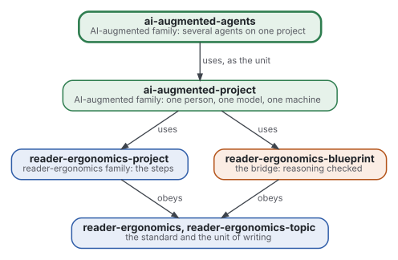
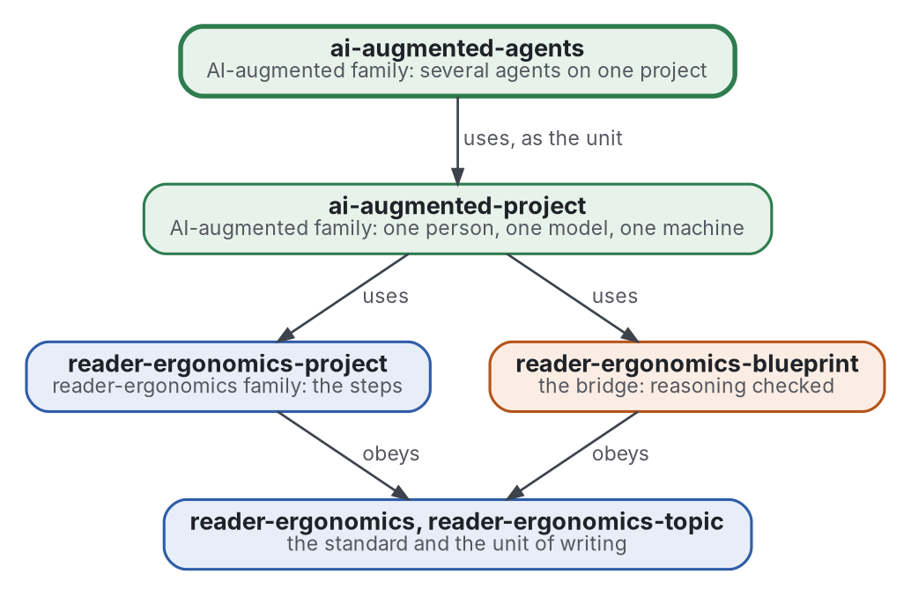

# Agents augmentés par l'IA

[](https://github.com/Tewf/ai-augmented-agents/actions/workflows/checks.yml)
[](https://tewf.github.io/ai-augmented-agents/)

Plusieurs **agents**, personnes et modèles de langue, sur un même projet : qui délègue quoi à qui, par quel brief, ce
que chacun décide, et ce qui les fait tirer dans le même sens. Le cas d'un seul modèle est
[ai-augmented-project](https://github.com/Tewf/ai-augmented-project). Ce dépôt demande ce qui change quand ils sont
nombreux, avec les outils de la théorie des jeux, de la théorie des équipes et de l'apprentissage par renforcement
multi-agents.

Cette page en anglais : [README.md](README.md). Les deux versions suivent le même état.

> **État (2026-11-03) :** version 0.1.0. Construit : la première passe de la revue de littérature (39 sources, un
> relecteur pour les sources formelles, un second évaluateur pour les grises, la référence nommée), deux exécutions sur le brief (210 appels), cinq principes et une forme,
> l'échange, chaque principe avec une vérification par programme, et les tests unitaires des vérifications et de
> l'exécution. Ouvert : la référence est nommée mais pas encore comparée à un chef centralisé, les exécutions portent sur trois
> tâches du même genre et deux niveaux de modèle, et les incitations et le décompte du travail en double n'ont pas de source. L'étape de
> cadrage a trouvé que le mot du domaine pour ce problème est **équipe**, non agent ; le nom reste. Ce n'est ni une
> norme officielle, ni une étude relue par des pairs, ni un résultat nouveau.
>
> **Comment il est fait :** avec Claude, un assistant IA d'Anthropic, sous la direction du mainteneur, comme
> reader-ergonomics. Les corrections sont bienvenues sous forme d'issues.

## L'adopter

Dix minutes, sans lire la revue. La forme générale est la section « Take your own version » de
[reader-ergonomics](https://github.com/Tewf/reader-ergonomics/blob/4f99372093729dacf982e9174e94f6b8793c513d/README.md#take-your-own-version) ; la voici pour la remise de travail entre agents.

1. **Épingler la norme par son commit**, pour que ses vérifications ne changent pas sous vos pieds :
   `git clone https://github.com/Tewf/reader-ergonomics && git -C reader-ergonomics checkout 4f99372` (v1.20.0).
2. **Copier ce dont vous avez besoin, une fois :** la [forme échange](shapes/exchange.md) avec son
   [exemple](shapes/examples/README.md), et les quatre vérifications de [checks/local/](checks/local/)
   (`task_headings.py`, `task_decided.py`, `task_checks.py`, `exchange_pairs.py`, avec l'aide `_exchange.py`) dans le
   `checks/local/` de votre dépôt. Nommez chaque paire `NN-slug.task.md` et `NN-slug.result.md`. Les copies sont à
   vous ; notez le commit d'où vous les avez prises.
3. **Configurer** avec un `checks/config.toml` :

   ```toml
   extends = "reader-ergonomics"
   ```

4. **Lancer les vérifications** depuis le dossier de votre dépôt : `python3 reader-ergonomics/checks/run.py .`
5. **Désaccord :** ouvrez une issue sur ce dépôt, avec la preuve. Une règle de la norme elle-même va aux issues de
   reader-ergonomics ; une préférence de votre lecteur va dans un style de lecteur, comme dérogation.

## Où il se place



<details>
<summary>Graphviz source</summary>



</details>

- **Il utilise [ai-augmented-project](https://github.com/Tewf/ai-augmented-project)** comme unité : un agent sur une
  étape est le cas de ce dépôt-là ; celui-ci arrange les unités.
- **Il obéit à [reader-ergonomics](https://github.com/Tewf/reader-ergonomics/blob/4f99372093729dacf982e9174e94f6b8793c513d/standard.md)** (v1.20.0) et exécute ses vérifications en CI.
- **Il ne pointe que vers le bas.** La carte de la famille est [ai-augmented](https://github.com/Tewf/ai-augmented).

## Périmètre

| | Quoi | Pourquoi |
|---|---|---|
| dedans | la délégation : quand remettre une étape à un autre agent vaut mieux que la faire, et ce que le brief doit tenir pour qu'un agent moins cher ait raison | la règle du mainteneur est de dépenser le jugement, pas le volume ; la règle a besoin d'une mesure |
| dedans | la coordination : comment plusieurs agents sur une famille de dépôts gardent un lieu par fait et une décision par question | six sessions ont bâti six dépôts en un jour ; ce qu'elles ont fait est la première donnée |
| dedans | les incitations : ce qu'une personne et un modèle optimisent chacun, et le jeu dans lequel ils sont, du problème principal-agent à la théorie des équipes et à la conception de mécanismes | l'économie a les modèles ; qu'un agent-modèle ait une incitation du tout reste ouvert |
| dedans | l'apprentissage : quand plusieurs agents s'améliorent à se coordonner, et ce qu'en dit l'apprentissage par renforcement multi-agents | le jeu répété, avec et sans modèle dedans |
| dehors | le cas d'un seul agent | [ai-augmented-project](https://github.com/Tewf/ai-augmented-project) |
| dehors | construire ou entraîner les modèles des agents | d'autres le font ; ce dépôt les arrange |
| dehors | le logiciel | [ai-augmented-ide](https://github.com/Tewf/ai-augmented-ide), plus tard |

## Le premier travail : une revue de littérature

Une première passe est écrite dans [evidence](evidence/multi-agent-teams/README.md) (en anglais). Elle suit l'ordre d'une revue de thèse, et elle est finie quand elle peut nommer la référence, ce qu'elle fait.

1. **Cadrer :** le problème en une phrase, et comment chaque domaine le nomme. Pistes à vérifier : systèmes
   multi-agents, problème principal-agent, théorie des équipes, conception de mécanismes, apprentissage par renforcement
   multi-agents, systèmes d'agents à modèle de langue. Le nom a été gardé ([frame](evidence/multi-agent-teams/frame.md)).
2. **Revue :** chaque nom, cherché par son nom académique, son acronyme et son auteur ; les synthèses d'abord.
   - l'économie de la délégation et des équipes : aléa moral dans les équipes, théorie des équipes, coût de la communication ;
   - les systèmes de plusieurs agents à modèle de langue, ce qu'on les mesure gagner sur un seul, et ce qu'ils perdent ;
   - la coopération dans les jeux répétés, avec des personnes et avec des agents apprenants ;
   - ce qu'un brief doit tenir : la littérature grise de la remise d'un travail à un exécutant moins cher.
3. **État de l'art, et le dossier contre.**
4. **Positionnement :** ce que ce dépôt demande et que le domaine ne répond pas déjà.
5. **Référence :** l'arrangement du mainteneur du 2026-10-29, une session coordinatrice et six propriétaires, écrit et
   comparé au meilleur arrangement trouvé par la revue.

## Questions auxquelles la revue doit répondre

- **Déléguer ou faire.** Quand remettre une étape à un agent moins cher, avec le temps de le briefer et de le vérifier,
  coûte-t-il moins que la faire ?
- **Le brief.** Que doit tenir un brief pour qu'un agent qui ne sait rien d'autre ait raison, et comment est-il vérifié ?
- **Incitations.** Une personne optimise quelque chose ; qu'optimise un agent-modèle, s'il optimise quoi que ce soit,
  et qu'en suit-il pour le jeu où ils sont ?
- **Coordination mesurée.** Que peut-on mesurer dans l'historique de plusieurs dépôts bâtis par plusieurs agents à la
  fois : décisions prises deux fois, faits écrits en deux lieux, questions parvenues à la personne ?

## Ce que la revue a trouvé

La première passe, avec une recherche en aval : 39 sources, dont 3 grises. Le détail et les niveaux de preuve sont dans [la revue](evidence/multi-agent-teams/review.md), en anglais.

- **Aucun domaine ne nomme le problème entier.** L'économie étudie les équipes de personnes (théorie des équipes, aléa moral dans les équipes), l'informatique étudie les programmes, et la pratique a ses propres mots ([frame](evidence/multi-agent-teams/frame.md)).
- **Plusieurs agents ne battent pas un seul de façon fiable.** Sur 260 configurations, la variation va de +80,8 % à -70,0 %, selon la tâche (mesuré). Un contrôle central a ramené l'amplification des erreurs de 17,2 fois à 4,4 fois. Chez les personnes, la même coupure apparaît : laisser le modèle diriger a fait tomber la reproduction à 37 %, contre 91 % quand il assiste (Brodeur 2026, secondaire).
- **Déléguer à un modèle moins cher paie, et se mesure comme un routage.** Une cascade a réduit le coût jusqu'à 98,3 % sur un jeu de données. Aucune source ne chiffre le temps de briefer et de vérifier. Lee 2026b mesure un coût de la délégation que l'économie ne montre pas (secondaire).
- **Le brief a une convention et aucun test.** Objectif, format de sortie, outils et limites sont conseillés par une entreprise à propos de son propre système ; aucune étude n'enlève un champ. Les exécutions suivent.
- **Les incitations et les comptes restent ouverts.** Aucune source ne montre qu'un agent-modèle a une incitation, et aucune ne compte les décisions prises deux fois ou les faits écrits deux fois.

## Les exécutions : le brief

Une tâche à réponse vérifiable, donnée à un petit modèle hébergé en trois bras, dix essais chacun, jugés par des tests unitaires ([protocole](experiments/brief-test/protocol.md), [résultats](experiments/brief-test/results.md), [décision 0003](decisions/0003-the-brief-is-tested-on-one-small-task.md), en anglais).

| Bras | Réussis sur 10 | Questions posées |
|---|---|---|
| sans brief | 0 | 0 |
| brief de la convention | 0 | 0 |
| convention plus les vérifications | 5 | 0 |

- Première série : la convention seule n'a pas aidé sur cette tâche ; lister les vérifications, si, sur les cas listés.

Deuxième série : trois tâches, deux niveaux (un petit modèle hébergé et claude-haiku-5-5), 180 appels, jugés par des cas cachés qu'aucun bras ne voit ([protocole](experiments/brief-test/protocol-2.md), [résultats](experiments/brief-test/results-2.md), [décision 0005](decisions/0005-listing-the-checks-is-not-a-gain-on-unseen-cases.md), en anglais).

| Bras | Cas cachés réussis sur 60 | Cas montrés réussis sur 60 |
|---|---|---|
| sans brief | 0 | 0 |
| brief de la convention | 30 | 38 |
| convention plus les vérifications | 29 | 42 |

- Les lignes « Décidé » portent l'effet : de 0 à 30 sur 60. La liste des vérifications n'apporte rien sur des cas non vus ; ce principe perd donc sa revendication sur le taux de réussite.
- Elle ne dit pas plus : trois tâches du même genre, un modèle par niveau, et les bras diffèrent par plus que l'information.

## La norme

La [fiche](standard.md) réunit cinq principes en deux groupes, chacun avec son niveau de preuve et une vérification qui tourne en CI. Lisez d'abord [reader-ergonomics](https://github.com/Tewf/reader-ergonomics/blob/4f99372093729dacf982e9174e94f6b8793c513d/standard.md).

| Principe | Niveau | Vérification |
|---|---|---|
| [List the checks](principles/brief/list-the-checks.md) | convention pour les parties ; soutenu avec réserve pour les vérifications | `task-headings` |
| [Say why it is handed over](principles/brief/say-why-handed-over.md) | mesuré ; convention pour la ligne | `task-decided` |
| [Escalate on a failed check](principles/brief/escalate-on-a-failed-check.md) | mesuré ; convention pour la ligne | `task-decided` |
| [Run the checks at the lead](principles/result/run-the-checks-at-the-lead.md) | mesuré ; convention pour la règle | `task-checks` |
| [Keep the result untouched](principles/result/keep-the-result-untouched.md) | convention | `exchange-pairs` |

L'unique forme est l'[échange](shapes/exchange.md) : un fichier de tâche, un fichier de résultat gardé tel qu'il est revenu, et le verdict ailleurs. Son exemple travaillé est la tâche du test du brief ([décision 0004](decisions/0004-which-findings-became-principles.md)).

## La référence

**B1** : l'arrangement du mainteneur du 2026-10-29, une session coordinatrice et six propriétaires, écrit pour cette revue. Il est comparé à un chef central qui emploie des briefs explicites et un contrôle central ([référence](evidence/multi-agent-teams/baseline.md)).

## Vérifier

```sh
git clone https://github.com/Tewf/reader-ergonomics && git -C reader-ergonomics checkout 4f99372
python3 reader-ergonomics/checks/run.py chemin/vers/ce/depot
```

La CI exécute d'abord les tests unitaires des vérifications et de l'exécution du brief, puis les mêmes vérifications, à chaque push, et une exécution échoue à la première erreur
([checks.yml](https://github.com/Tewf/ai-augmented-agents/blob/master/.github/workflows/checks.yml)). Chaque push sur
master construit aussi le site, [tewf.github.io/ai-augmented-agents](https://tewf.github.io/ai-augmented-agents/)
([pages.yml](https://github.com/Tewf/ai-augmented-agents/blob/master/.github/workflows/pages.yml)).

## Contenu

| Partie | Résumé |
|---|---|
| [standard](standard.md) | la fiche : cinq principes pour confier un travail d'un agent à un autre, avec leurs niveaux (en anglais) |
| [principles](principles/) | un fichier par principe : énoncé, niveau, preuve, vérification et limites (en anglais) |
| [shapes](shapes/) | l'échange : le fichier de tâche, le fichier de résultat et le verdict, avec un exemple travaillé (en anglais) |
| [evidence](evidence/) | la revue derrière ce dépôt : cadrage, protocole, sources, résultats, position et référence (en anglais) |
| [experiments](experiments/) | des exécutions des questions ci-dessus, avec protocole, code et résultats (en anglais) |
| [decisions](decisions/) | une fiche par choix qui façonne ce dépôt, chacune ouvrant sur la décision en une phrase |

## Licence

Code sous [Apache License 2.0](LICENSE) ; prose sous [CC BY 4.0](LICENSES/CC-BY-4.0.txt). Réutilisez-le comme vous le
souhaitez, en créditant ce dépôt ; [CITATION.cff](CITATION.cff) donne une citation si besoin.
