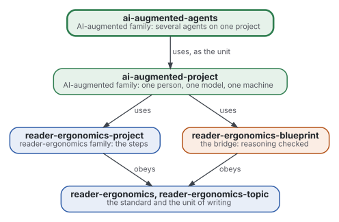
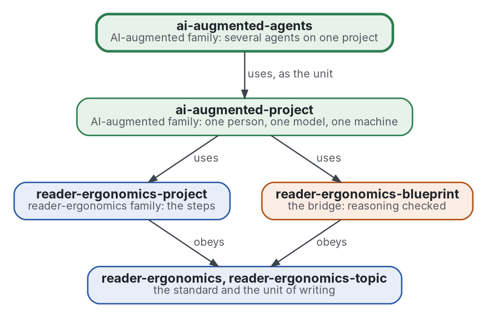

# AI-augmented agents

[](https://github.com/Tewf/ai-augmented-agents/actions/workflows/checks.yml)
[](https://tewf.github.io/ai-augmented-agents/)

Several **agents**, people and language models, working one project: who delegates what to whom, by what brief, what
each one decides, and what makes them pull the same way. The one-model case is
[ai-augmented-project](https://github.com/Tewf/ai-augmented-project); this repository asks what changes when there are
many, with the tools of game theory, team theory and multi-agent reinforcement learning.

This page in French: [README.fr.md](README.fr.md).

> **Status (2026-11-03):** the first pass of the literature review is written: 35 sources, one reviewer, the baseline
> named. One small run on the brief has been made (30 calls). Five principles and one shape, the exchange, are written, each with a program check. The frame step found
> that the field's word for the problem is **team**, not agent; the name stays. It is not an official standard, not a peer-reviewed study and not a new result.
>
> **How it is made:** with Claude, an AI assistant by Anthropic, under the maintainer's direction, the way
> reader-ergonomics was made. Corrections are welcome as issues.

## Where it sits



<details>
<summary>Graphviz source</summary>



</details>

- **It uses [ai-augmented-project](https://github.com/Tewf/ai-augmented-project)** as the unit: one agent on one step is
  that repository's case; this one arranges the units.
- **It obeys [reader-ergonomics](https://github.com/Tewf/reader-ergonomics/blob/b9732b9814c71768f722691f3c5049ec2b8ed378/standard.md)** (v1.19.2) and runs its checks in CI.
- **It links down only.** The family's map is [ai-augmented](https://github.com/Tewf/ai-augmented).

## Scope

| | What | Why |
|---|---|---|
| in | delegation: when handing a step to another agent beats doing it, and what the brief must hold for a cheaper agent to be right | the maintainer's rule is to spend judgment, not volume; the rule needs a measure |
| in | coordination: how several agents on one family of repositories keep one place per fact and one decision per question | six sessions built six repositories in one day; what they did is the first data |
| in | incentives: what a person and a model each optimise, and the game they are in, from the principal-agent problem to team theory and mechanism design | economics has the models; whether a model agent has an incentive at all is open |
| in | learning: when several agents improve at coordinating, and what multi-agent reinforcement learning says about it | the repeated game, with and without a model in it |
| out | the one-agent case | [ai-augmented-project](https://github.com/Tewf/ai-augmented-project) |
| out | building or training the agents' models | others do it; this arranges them |
| out | the software | [ai-augmented-ide](https://github.com/Tewf/ai-augmented-ide), later |

## The first job: a literature review

A first pass is written in [evidence](evidence/multi-agent-teams/README.md). It follows the order of a thesis review, and it is finished when it can name the baseline, which it does.

1. **Frame:** the problem in one sentence, and what each field calls it. Leads to verify: multi-agent systems, the
   principal-agent problem, team theory, mechanism design, multi-agent reinforcement learning, systems of language-model
   agents. The name was kept ([frame](evidence/multi-agent-teams/frame.md)).
2. **Review:** each name, searched by its academic name, its acronym and its author; surveys first.
   - the economics of delegation and of teams: moral hazard in teams, team theory, the cost of communication;
   - systems of several language-model agents, what they are measured to gain over one, and what they lose;
   - cooperation in repeated games, with people and with learning agents;
   - what a brief must hold: the grey literature of handing work to a cheaper worker.
3. **State of the art, and the case against.**
4. **Position:** what this repository asks that the field does not already answer.
5. **Baseline:** the maintainer's own arrangement of 2026-10-29, one coordinating session and six owners, written
   down and compared with the best arrangement the review found.

## Questions the review must answer

- **Delegate or do.** When does handing a step to a cheaper agent, with the time to brief and to check it, cost less
  than doing it?
- **The brief.** What must a brief hold for an agent that knows nothing else to be right, and how is it checked?
- **Incentives.** A person optimises something; what does a model agent optimise, if anything, and what follows for
  the game they are in?
- **Measured coordination.** What can be measured from the history of several repositories built by several agents
  at once: decisions taken twice, facts written in two places, questions that reached the person?

## What the review found

The first pass: 35 sources, 3 of them grey. Details and grades are in [the review](evidence/multi-agent-teams/review.md).

- **No field names the whole problem.** Economics studies teams of people (team theory, moral hazard in teams), computer science studies programs, and practice has its own words ([frame](evidence/multi-agent-teams/frame.md)).
- **Many agents do not reliably beat one.** Over 260 configurations the change ran from +80.8% to -70.0%, set by the task (measured). A central check cut error amplification from 17.2 times to 4.4 times.
- **Delegating to a cheaper model pays, and is measured as routing.** A cascade cut cost by up to 98.3% on one dataset. No source prices briefing and checking.
- **The brief has a convention and no test.** Objective, output format, tools and boundaries are advised by one company about its own system; no study removes one field. A first run is below.
- **Incentives and counts are open.** No source shows a model agent has an incentive, and none counts decisions taken twice or facts written twice.

## The first run: the brief

One task with a checkable answer, given to a small hosted model in three arms, ten runs each, judged by unit tests ([protocol](experiments/brief-test/protocol.md), [results](experiments/brief-test/results.md), [decision 0003](decisions/0003-the-brief-is-tested-on-one-small-task.md)).

| Arm | Passed of 10 | Questions asked |
|---|---|---|
| no brief | 0 | 0 |
| convention brief | 0 | 0 |
| convention plus the checks | 5 | 0 |

- The convention alone did not help on this task; listing the checks did.
- It cannot say more: one task, one model, ten runs, and the last arm is shown the cases it is judged by.

## The standard

The [card](standard.md) holds five principles in two groups, each with its grade and a check that runs in CI. Read [reader-ergonomics](https://github.com/Tewf/reader-ergonomics/blob/b9732b9814c71768f722691f3c5049ec2b8ed378/standard.md) first.

| Principle | Grade | Check |
|---|---|---|
| [List the checks](principles/brief/list-the-checks.md) | convention for the parts; supported with caveat for the checks | `task-headings` |
| [Say why it is handed over](principles/brief/say-why-handed-over.md) | measured; convention for the line | `task-decided` |
| [Escalate on a failed check](principles/brief/escalate-on-a-failed-check.md) | measured; convention for the line | `task-decided` |
| [Run the checks at the lead](principles/result/run-the-checks-at-the-lead.md) | measured; convention for the rule | `task-checks` |
| [Keep the result untouched](principles/result/keep-the-result-untouched.md) | convention | `exchange-pairs` |

The one shape is the [exchange](shapes/exchange.md): a task file, a result file kept as it came, and the verdict elsewhere. Its worked example is the brief test's own task ([decision 0004](decisions/0004-which-findings-became-principles.md)).

## The baseline

**B1**: the maintainer's arrangement of 2026-10-29, one coordinating session and six owners, written down for this review. It is compared with a central lead that uses explicit briefs and a central check ([baseline](evidence/multi-agent-teams/baseline.md)).

## Check it

```sh
git clone https://github.com/Tewf/reader-ergonomics
python3 reader-ergonomics/checks/run.py path/to/this/repository
```

CI runs the same checks on every push, and a run fails on any error
([checks.yml](https://github.com/Tewf/ai-augmented-agents/blob/master/.github/workflows/checks.yml)). Every push to
master also renders the site, [tewf.github.io/ai-augmented-agents](https://tewf.github.io/ai-augmented-agents/)
([pages.yml](https://github.com/Tewf/ai-augmented-agents/blob/master/.github/workflows/pages.yml)).

## Contents

| Part | Summary |
|---|---|
| [standard](standard.md) | the card: five principles on handing work from one agent to another, with their grades |
| [principles](principles/) | one file per principle: claim, grade, evidence, check, and where it stops |
| [shapes](shapes/) | the exchange: the task file, the result file and the verdict, with a worked example |
| [evidence](evidence/) | the review behind this repository: frame, protocol, sources, findings, position and baseline |
| [experiments](experiments/) | runs of the questions above, with protocol, code and results |
| [decisions](decisions/) | one record per choice that shapes this repository, each opening with the decision in one sentence |

## Licence

Code under the [Apache License 2.0](LICENSE); prose under [CC BY 4.0](LICENSES/CC-BY-4.0.txt). Reuse it as you wish,
with credit to this repository; [CITATION.cff](CITATION.cff) gives a citation if you need one.
