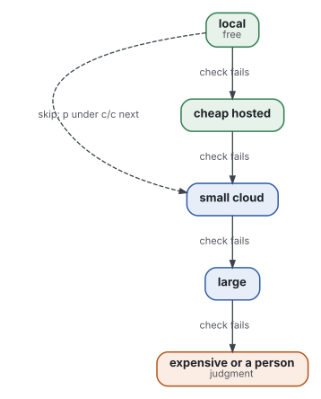
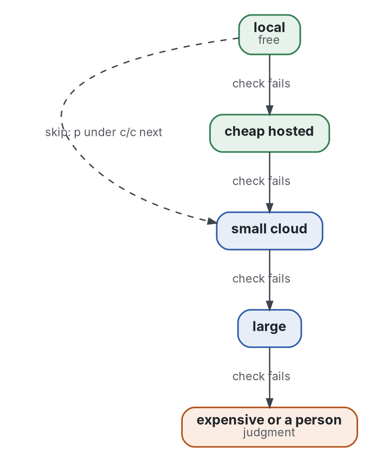
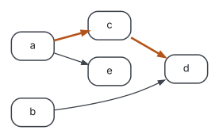
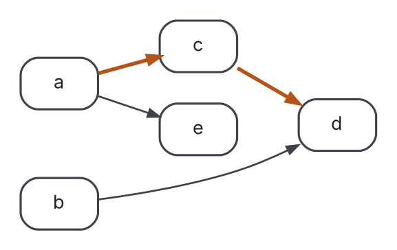

# The maestro protocol: tiers, order and cap

Three rules for a lead who hands work to cheaper workers: cheapest tier first, waves from dependencies, a cap spent by gain per cost. Every number in it is an estimate until the cost of each job is recorded.

Follows the [topic shape](https://github.com/Tewf/reader-ergonomics-topic/blob/86e14fe9a1a9877d6a87a2f8b4e8713f98724b5a/shapes/topic.md).

## Terms

- **Tier:** a kind of worker, from the cheapest up: local model, cheap hosted model, small cloud model, large model, expensive model or a person.
- **Cost c:** what a job spends, in one unit for the whole file (tokens, meter points or dollars).
- **Pass share p:** the share of a tier's answers that a program accepts, read from the log of past jobs.
- **Gain g:** the lead's estimate of what a job is worth, on any scale, the same for all jobs.
- **Critical path:** the longest chain of jobs that wait for each other; no schedule is shorter.
- **Wave:** the jobs that can start together because everything they wait for is done.

## Rule 1: tiers, cheapest first, skipped by arithmetic

Graphviz source

- **Try** the cheapest tier for which a program can accept the answer. The check of the [exchange](../shapes/exchange.md) says what accepts.
- **Escalate** when the check fails, as the task's line "If the check fails" says. This is a cascade (Chen 2023b), here with a program as the scorer.
- **Skip a tier** in two cases:
  - No program can accept its answer. An error would go unnoticed there, so the work goes straight to the tier that keeps judgment.
  - Its pass share is under break-even. Trying tier t before the next costs ct plus, when t fails, cnext. It beats going straight to the next tier when pt &gt; ct / cnext. The arithmetic is exact; p is read from the log, and with no log p is a guess.
- **Budget rule:** a job's tiers together may spend at most its own cost estimate, the cost at the tier that would do it alone. A tier whose share falls under break-even stays skipped until the log shows it has recovered.
- Hyperband, the bandit form of the same idea, halves a field of candidates as the budget per candidate grows. It applies when many candidates compete; one task handed down a ladder is the cascade.

## Rule 2: order from a precedence graph

Graphviz source

- **Write** each job's `after` list in the [jobs file](jobs.toml): the jobs whose output it reads or whose approval it needs, with a cost estimate and, when known, a gain.
- **Run** `python3 protocols/schedule.py jobs.toml --compare`. It prints the critical path, the waves, and the jobs that ran later than the first wave they could.
- **Launch** a job as soon as everything it waits for is done. A wave count above the critical path length needs a stated reason for each extra wave, such as a review the lead reads first, or a budget gate. A reason that is not a dependency is a resource, and is written as one.
- The program is list scheduling with unlimited workers; with a limit on how many run at once, the path is still the lower bound and the waves are the best case.

## Rule 3: the cap, spent by gain per cost

- **Rank** the queued jobs by g / c and launch in that order, among the jobs whose predecessors are chosen. `schedule.py jobs.toml --rank --cap N` prints the order and the jobs left out when N is reached.
- A job with no gain estimate is never chosen by the program: the order is only as good as its estimates.
- **Gains are estimates.** Until each job's cost and a verdict on whether it moved the work are recorded, the ranking is the lead's opinion in a form a program can sort. The cost is the Cost line of the [exchange](../shapes/exchange.md). The ranking is not a measurement, and it is not shown to beat the rule it replaces, the cheapest worker that can do the job.
- **Success test:** a period in which the cap is not reached before the highest-ranked jobs are done.
- The lead keeps what no estimate holds: the stakes of a job. A high-stakes job with a low ratio is moved up by hand, and the move is written next to the ranking.

## Reading the maintainer's two days

[The jobs file](jobs.toml) is read from the maintainer's log of two days. On it the program finds:

- a critical path of 7 waves, where the log shows 12 steps;
- 23 of 27 jobs run later than their first possible wave;
- two reasons in the log that are not dependencies: a budget gate that held the second batch of reviews back, and a review of every result before the next wave;
- the chain from the design document to the spike ran in the order the path gives, each link one or two waves late.

The costs in the file are rounded estimates, so the comparison is of order and wave counts only, not of hours.

## Sources

- Chen 2023b: the cascade. Read in full. Measured on its datasets.
- The map's pages on [tiers](https://github.com/Tewf/ai-augmented-practice/blob/master/map/tiers.md), [batches](https://github.com/Tewf/ai-augmented-practice/blob/master/map/batches.md) and [the budget cap](https://github.com/Tewf/ai-augmented-practice/blob/master/map/the-budget-cap.md) hold the algorithms, their sources and the reference implementations.
- Grade of the protocol: convention. The break-even rule and the critical path are arithmetic; that they save anything for one lead is untested.

## See also

[The exchange shape](../shapes/exchange.md); [the baseline](../evidence/multi-agent-teams/baseline.md); [decision 0006](../decisions/0006-the-maestro-protocol-is-not-a-principle.md).
